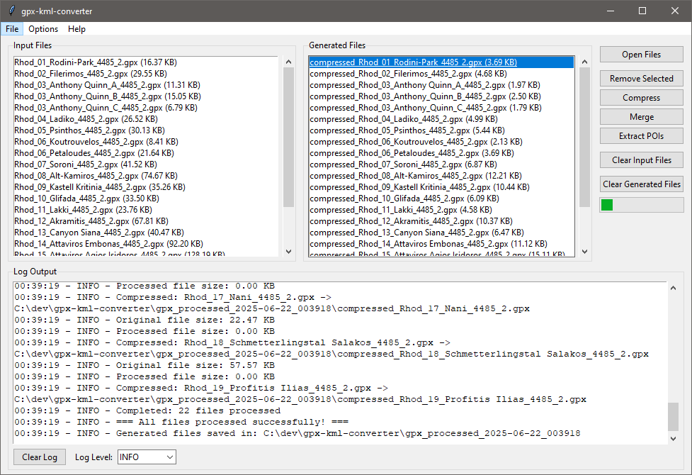
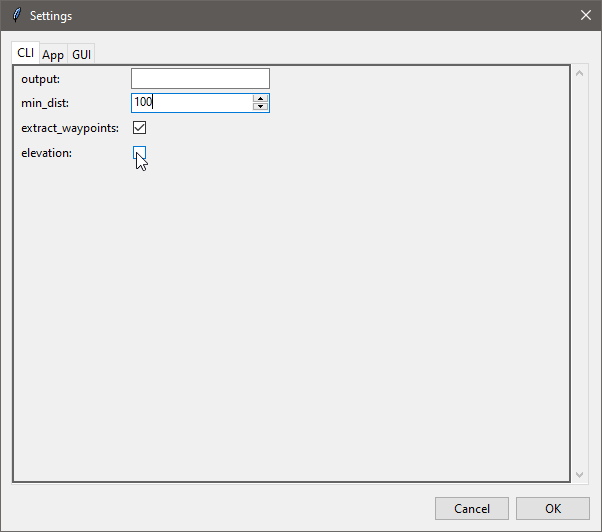

# Graphical user interface (GUI)

The GUI provides a non-destructive workspace for browsing and processing GPX,
KML, and ZIP inputs.

## Getting started with the GUI

1. **Open files:** Click **Open Files** (or **File → Open…**) and select one or
   more GPX, KML, or ZIP files. Loaded files appear under **Inputs** in the
   workspace. Recently opened files are also listed under **File → Recent
   Files**.
2. **Select files (optional):** Click files in the input list to select them for
   processing. If no files are selected, processing uses all loaded inputs.
   **Select All Inputs** selects every input explicitly.
3. **Inspect:** Select a file to view its track, route, and POI counts and total
   track distance. The selection is shown on the map; selected tracks also show
   an elevation profile.
4. **Process:** Choose **Compress Files**, **Merge Files**, or **Extract POIs
   from Tracks**. A confirmation preview shows the file and point counts before
   processing starts. Generated results appear under **Generated**.
5. **Find the result:** After processing, the completion summary shows how many
   files were processed and where the results lie. Click the output path to open
   the containing folder in the file system.

Optional: choose a custom output folder per run via the **Output folder →
Choose…** control; results are written there instead of the default location.

## Workspace and inspection

- Use **Open Files** to add source files. Files appear under **Inputs**; processed
  and edited copies appear under **Generated**.
- Select input file rows to choose a batch. If no input file rows are selected,
  processing uses all loaded inputs. **Select All Inputs** explicitly selects
  every input. Selecting a track, route, or POI changes inspection only.
- Select a file to inspect its track, route, and POI counts and total track
  distance. Select an artifact to inspect its metadata; its containing file is
  shown on the map, and selected tracks also show an elevation profile.
- Double-click a file or artifact to open its source file in the system's
  default application. Double-clicking an unsaved working copy opens its
  unchanged source and records a warning in the log.

## Context menu and removal

Right-click a file or artifact to open its context menu. **Open Containing
Folder** opens the folder containing the physical source. For a file, **Remove
from Workspace** removes the selected file entry from the GUI only; it never
deletes the disk file. Select multiple files to remove them together.

Tracks, routes, and POIs can also be removed. The selection must contain only
one node type; mixed file/artifact or mixed artifact-type selections are
blocked. Selecting a Tracks, Routes, or POIs category removes all items in that
category. Artifact removal creates a new in-memory entry under **Generated**;
the source and its GPX content are not modified. The Delete key performs the
same removal as the context menu.

## Processing

Choose **Process Files**, **Merge Files**, or **Extract POIs from Tracks**.
Generated results remain in the workspace. To process a result in a later
step, select it and choose **Use Selected Results as Inputs**.

By default, **Compress Files** writes each result beside its source using
`<source-stem>_processed_<date-time>.gpx`. For files loaded from a ZIP archive,
results go in a sibling directory named after the archive without its
extension; each result uses
`<member-stem>_processed_<date-time>.gpx`. **Merge Files** writes
`gpx_processed_<date-time>.gpx` in the current directory. An explicit output
directory overrides these destinations. Existing output names are overwritten;
duplicate names produced by one batch receive a numeric suffix.

## Empty states and onboarding

When the workspace is empty (no files loaded), an onboarding hint is shown in
the workspace area pointing to **Open Files** as the first step. After files are
loaded, the hint disappears and the workspace shows **Inputs** and
**Generated** sections.

## Main Window Overview

## Settings Dialog

## Troubleshooting

| Problem | Possible cause | Solution |
|---------|----------------|----------|
| SRTM elevation data unavailable | No network connection or SRTM tile missing for the region | Processing continues using the original elevation values from the file or defaults to zero. A warning is logged. |
| KML file does not open | The KML uses features not supported by the importer | Verify the file is a valid KML/KMZ. Try opening it in another tool to confirm it is readable. |
| Log panel is empty | Log level set too high | Change the log level in the docked log panel (or **View → Show Log**) to **DEBUG** or **INFO**. |
| Output path not found | Results were written to a different folder | Check the completion summary's output path and click it to open the containing folder. Alternatively, set a custom output folder via **Output folder → Choose…**. |
| Workspace appears empty | No input files loaded yet | Click **Open Files** to load GPX, KML, or ZIP files. The empty-state hint points to this first step. |
